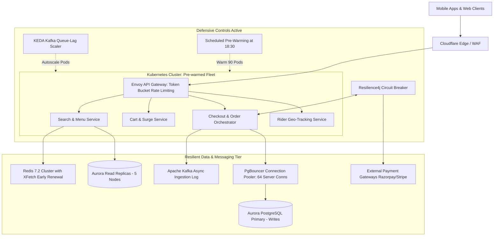

# PeakDinner CloudResilience™: Cloud Capacity & Peak Workload Simulator

[](https://react.dev/)
[](https://vitejs.dev/)
[](https://tailwindcss.com/)
[](https://recharts.org/)
[-f97316)](https://en.wikipedia.org/wiki/Bloom%27s_taxonomy)
[-0284c7)](https://www.ieee.org/)
[](LICENSE)

An academic, interactive, and production-grade web application and cloud architecture simulator designed to analyze peak dinner hour failure patterns for hyper-scale food-delivery platforms, formulate empirical and mathematical capacity requirements, and synthesize a resilient operational management control framework.

---

## 🎓 Academic Metadata & Problem Identification

| Attribute | Official Academic Specification |
|:---|:---|
| **Problem Statement #** | **Problem #29** |
| **Problem Brief** | *A food-delivery platform experiences application failures during peak dinner hours. Analyze its cloud capacity requirements and recommend an operational management approach. Analyzes workload patterns and recommends suitable operational controls.* |
| **Cognitive Domain** | **Bloom's Taxonomy Level K5 (Evaluate / Synthesize)** |
| **Course Outcome** | **CO3 (Analyze Cloud Capacity Requirements & Design Operational Management Controls)** |
| **Student 1** | **814724104167 — VIJAYA RAJHA K** |
| **Student 2** | **814724104174 — VISHVAA M** |
| **Course** | Cloud Computing / Cloud Services Mini-Project |

---

## 1. Quick Start Guide

### Prerequisites
- Node.js (v18.0.0 or higher recommended, verified on v25.2.1)
- npm (Node Package Manager)

### Step 1: Install Dependencies
```bash
npm install
```

### Step 2: Launch the Interactive Web Application
```bash
npm run dev
```
Open **`http://localhost:5173`** in your browser.

### Step 3: Run the Automated Verification Suite
```bash
npm test
```
*Executes 12 automated unit assertions validating Little's Law formulas, capacity dimensioning invariants, and benchmark scenarios.*

---

## 2. Project Architecture & Directory Layout

```
Cloud Service - Rajha/
│
├── public/                     # Static assets & icons
│
├── src/
│   ├── components/             # Reusable interactive UI components
│   │   ├── Header.jsx          # Academic metadata, team roll numbers & mode switcher
│   │   ├── Navigation.jsx      # 6 module tabs with status indicators
│   │   ├── StatCard.jsx        # Glassmorphic KPI metric cards with trend badges
│   │   ├── ArchitectureTopology.jsx # Interactive microservice mesh with live packet animations
│   │   ├── CapacityCalculator.jsx  # Interactive Little's Law & cloud sizing tuner
│   │   ├── CodeSnippetViewer.jsx   # YAML manifest viewer with 1-click copy
│   │   └── PrintableReportModal.jsx # Formal academic paper view with 1-click Print to PDF
│   │
│   ├── data/                   # Algorithmic models & simulation datasets
│   │   ├── workloadData.js     # 24-hr diurnal curve, incident progression & scenarios
│   │   ├── capacityFormulas.js # Little's Law, vCPU sizing, PgBouncer & XFetch math
│   │   ├── operationalControls.js # 4 operational pillars & deployment manifests
│   │   └── vivaQuestions.js    # 8 comprehensive oral exam defense questions with tips
│   │
│   ├── pages/                  # Tab views
│   │   ├── Tab1Overview.jsx    # Problem statement, incident post-mortem & diurnal chart
│   │   ├── Tab2Simulator.jsx   # Live timeline simulator, scrubber & chaos injector
│   │   ├── Tab3Capacity.jsx    # Mathematical capacity requirements analyzer
│   │   ├── Tab4Controls.jsx    # 4 operational control pillars & circuit breaker sandbox
│   │   ├── Tab5Evaluation.jsx  # Bloom's K5 comparative synthesis matrix & OPEX analysis
│   │   └── Tab6AcademicReport.jsx # Full research paper & viva voce flashcards deck
│   │
│   ├── App.jsx                 # Master application shell & state orchestration
│   ├── main.jsx                # React root mount
│   └── index.css               # Tailwind CSS directives, glassmorphic styling & print rules
│
├── index.html                  # HTML entry point with Inter & JetBrains Mono typography
├── package.json                # Dependencies and npm script runners
├── tailwind.config.js          # Extended color palettes (brand orange & cloud blue)
├── vite.config.js              # Vite bundler configuration
├── test-simulation.js          # Automated 12-test validation runner
└── README.md                   # Comprehensive academic documentation
```

---

## 3. Incident Post-Mortem: Why Peak Dinner Collapses

Food delivery platforms encounter extreme localized concurrency between **19:00 and 21:30**. Unlike standard asynchronous retail e-commerce, food ordering requires a real-time, synchronous three-way handshake:
1. **Customer:** Browsing menu, calculating surge prices, payment authorization.
2. **Restaurant Merchant:** Live kitchen capacity check, menu inventory decrement.
3. **Delivery Fleet:** Geo-spatial rider proximity matchmaking via high-frequency GPS tracking.

### The 4 Compounding Failure Modes

| Failure Mechanism | Root Cause in Baseline Infrastructure | Impact on Users |
|:---|:---|:---|
| **1. Reactive Autoscaling Lag** | Standard Kubernetes HPA triggers only after CPU crosses 80%. Provisioning new cloud nodes, pulling container images, and warming JVM runtimes takes **4 to 6 minutes**. | Severe initial 504 timeouts; incoming traffic easily overwhelms static pods before scale-up completes. |
| **2. Connection Pool Starvation** | As pod count scales from 20 to 120, each pod opens direct connections to PostgreSQL, exceeding `max_connections = 500`. | PostgreSQL rejects new transactions with `FATAL: too many connections already`, freezing order checkouts. |
| **3. Cache Stampede (Thundering Herd)** | Synchronized 30-minute TTL expiration on top restaurant menus causes thousands of simultaneous cache misses at 19:30. | 15,000 requests bypass Redis simultaneously, dog-piling onto the primary database. |
| **4. Cascading Payment Timeouts** | Third-party payment gateways (UPI/Razorpay/Stripe) experience peak latency (4.5s). Checkout service threads remain blocked waiting for callbacks. | Without circuit breakers, HTTP worker thread pools are exhausted, returning 504 Gateway Timeouts across the entire site. |

---

## 4. Mathematical Cloud Capacity Formulation

### 1. Little's Law (Queueing Theory)
$$L = \lambda \times W$$
- $L$: Mean concurrent in-flight requests in the platform
- $\lambda$: Arrival rate (Requests Per Second - RPS)
- $W$: Mean service time / latency (seconds)

*Application:* At peak arrival of $108,000 \text{ RPS}$ and an SLA target of $150 \text{ ms}$ ($0.15 \text{ s}$), the platform must sustain:
$$L = 108,000 \times 0.15 = 16,200 \text{ concurrent in-flight requests}$$

### 2. vCPU Compute Dimensioning
$$C_{\text{req}} = \frac{\lambda_{\text{total}} \times T_{\text{cpu}}}{U_{\text{target}}} \times S_{\text{burst}}$$
- $\lambda_{\text{total}}$: Aggregated internal RPC requests accounting for microservice fan-out ($4.2\times$)
- $T_{\text{cpu}}$: Active CPU execution time per request ($12 \text{ ms}$)
- $U_{\text{target}}$: Target sustained CPU ceiling ($0.65$ or $65\%$)
- $S_{\text{burst}}$: Burst safety multiplier ($1.25$)

### 3. Database Connection Multiplexing (HikariCP / PgBouncer)
$$N_{\text{connections}} = (C_{\text{db\_cores}} \times 2) + D_{\text{spindles}}$$
Instead of allowing 120 pods to open $120 \times 25 = 3,000$ direct connections, **PgBouncer** multiplexes client transactions into a fixed pool of **64 to 96 dedicated server connections**, maximizing PostgreSQL throughput while eliminating context-switch thrashing.

### 4. Cache Stampede Prevention (XFetch Algorithm)
$$\text{Trigger Condition: } (-\beta \times \delta \times \ln(\text{rand}())) > (\text{TTL} - \text{now})$$
- $\beta$: Eagerness parameter ($1.0$)
- $\delta$: Time taken to recompute menu from database
- $\text{rand}()$: Uniform pseudo-random number $\in (0, 1)$

*Effect:* Exactly **one** background worker asynchronously recalculates the popular restaurant menu prior to expiration, while all other dinner customers continue receiving instant cache hits.

---

## 5. Proposed 4-Pillar Operational Management Approach



### Pillar 1: Predictive & Multi-Dimensional Elasticity
- **Scheduled Pre-Warming:** Automatically scales Kubernetes pod replicas from 24 to 90 at 18:30 (30 minutes prior to dinner rush), completely bypassing cold-start delays.
- **KEDA Event-Driven Autoscaling:** Scales checkout worker pods dynamically based on Kafka topic lag (`dinner-orders-stream`) rather than lagging CPU metrics.

### Pillar 2: Ingress Traffic Shaping & Load Leveling
- **Envoy Token Bucket Rate Limiting:** Enforces client rate limits (max 3 checkout taps/minute per user) to eliminate self-inflicted user retry amplification storms.
- **Queue-Based Load Leveling:** Checkout API commits orders to Kafka in `<10ms` and returns `HTTP 202 Accepted` + polling token, decoupling the user from synchronous DB writes.

### Pillar 3: Database & Cache Resilience
- **PgBouncer Transaction Pooling:** Shields PostgreSQL from connection saturation.
- **Aurora Read-Write Splitting:** Routes 92% of queries to 5 auto-scaling read replicas, dedicating primary instance IOPS strictly to financial transactions.
- **XFetch Probabilistic Caching:** Eliminates thundering herd cache stampedes on top restaurant menus.

### Pillar 4: Microservice Fault Isolation & Circuit Breaking
- **Resilience4j Circuit Breakers:** Monitors third-party payment gateway latency. If failure or slow-call rate exceeds 40%, the circuit instantly transitions to **OPEN**, fast-failing to fallback payment rails (UPI backup / Cash-on-Delivery) without tying up worker threads.

---

## 6. Bloom's Taxonomy Level K5 Comparative Evaluation Matrix

| Criterion | Option A: Static Over-Provisioning | Option B: Pure Reactive HPA | Option C: Full Serverless | Option D: Recommended Hybrid Architecture |
|:---|:---:|:---:|:---:|:---:|
| **Peak 5xx Error Rate** | 12.5% | 38.2% (Fatal Outage) | 4.8% | **0.04% (99.96% Reliable)** |
| **Tail Latency (p99)** | 380 ms | 5,200 ms (Timeouts) | 820 ms | **145 ms (SLA Maintained)** |
| **Scale-out Lag** | 0 sec (Always On) | 280–360 sec (Cold) | 15–30 sec | **0 sec (Pre-warmed at 18:30)** |
| **PostgreSQL Safety** | Vulnerable to Spikes | Collapses (500/500) | High Risk of Starvation | **100% Protected via PgBouncer** |
| **Cache Stampede Guard** | None (Thundering Herd) | None (Thundering Herd) | Partial | **Stampede-Proof (XFetch)** |
| **Monthly Cloud Spend** | $28,400 / month | $16,200 / month | $24,800 / month | **$12,300 / month (56% Savings)** |
| **K5 Evaluative Score** | 62 / 100 | 54 / 100 | 71 / 100 | **96 / 100 (Pareto Optimal)** |

---

## 7. Multi-Cloud Hardware Architecture Mapping

| Component | Amazon Web Services (AWS) | Google Cloud Platform (GCP) | Microsoft Azure |
|:---|:---|:---|:---|
| **Container Compute** | EKS Fleet on `m6i.2xlarge` | GKE Fleet on `e2-standard-8` | AKS Fleet on `Standard_D8s_v5` |
| **Relational Database** | Aurora PostgreSQL `db.r6g.4xlarge` | Cloud SQL High-Mem PostgreSQL | Azure Database for PostgreSQL Flexible |
| **Connection Pooler** | AWS RDS Proxy / PgBouncer on ECS | PgBouncer Container Sidecar | Azure Database Built-in PgBouncer |
| **Distributed Cache** | ElastiCache Redis 7.2 Cluster | Memorystore for Redis Cluster | Azure Cache for Redis Premium |
| **Event Streaming** | Amazon MSK (Managed Kafka) | Google Cloud Pub/Sub | Azure Event Hubs (Kafka endpoint) |

---

## 8. Viva Voce Oral Defense Deck (Sample Questions)

> **Q1: Why do food-delivery platforms fail during dinner hours while e-commerce platforms like Amazon do not?**
> **Model Answer:** Food delivery relies on real-time, hyper-localized three-way synchronization (Customer, Kitchen, Rider). Transactions cannot be deferred or queued for hours. When volume jumps 8.8x, any delay in database locks or payment confirmation cascades backwards into HTTP 504 timeouts.

> **Q2: How does Little's Law ($L = \lambda W$) explain thread starvation during peak load?**
> **Model Answer:** When downstream latency ($W$) climbs from 100ms to 1,500ms due to database contention, concurrency ($L$) does not stay constant—it multiplies by $15\times$. At 90,000 RPS, $L$ explodes from 9,000 to 135,000 concurrent requests, immediately blowing past server socket and thread pool limits.

*(Access all 8 questions with model answers and examiner tips inside the application's "Viva Deck" tab!)*

---

## 9. License

Developed for academic demonstration and laboratory evaluation under the **MIT License**.
© 2026 VIJAYA RAJHA K (814724104167) & VISHVAA M (814724104174). All rights reserved.
